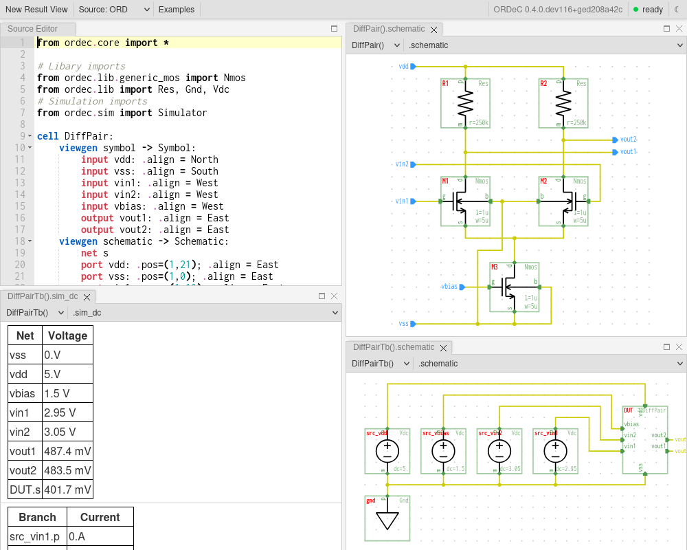

[](https://opensource.org/licenses/Apache-2.0)
[](https://api.reuse.software/info/github.com/tub-msc/ordec)
[](https://pypi.python.org/pypi/ordec)
[](https://ordec.readthedocs.io)
[](https://github.com/tub-msc/ordec/actions/workflows/tests.yaml)

**ORDeC** (Open Rapid Design Composer) is an open-source **custom IC design platform**. Its goal is to provide an accessible and streamlined interface to design and analyze analog, mixed-signal and custom digital integrated circuits from schematic to layout. ORDeC consists of:

- the ORD hardware description language (HDL) for design entry,
- a data model and data structures for representing IC design data (such as schematics),
- external tool integration (e.g. to Ngspice for simulation),
- a web interface for immediate graphical feedback during the design process.

ORDeC is developed by the [Mixed Signal Circuit Design Group](https://www.tu.berlin/msc) at Technische Universität Berlin. 

The development of ORDeC is currently at an early, experimental stage. The main branch of this repository provides a **working demo of some basic features and ideas**:



Further documentation is located in the *docs/* folder and is available online: https://ordec.readthedocs.io/

## Quick start with Docker

The Docker image contains ORDeC with all tools (Ngspice, KLayout, Yosys, OpenVAF) and PDKs (SKY130, IHP-Open-PDK):

```
docker pull ghcr.io/tub-msc/ordec:latest
docker run --rm -p 127.0.0.1:8100:8100 -it ghcr.io/tub-msc/ordec:latest
```

Then, access the web interface via the generated URL and try out examples.

## Installation with Nix

[Nix](https://nixos.org/download) is the recommended way to work with ORDeC locally. It provides the same tools and PDKs as the Docker image. The Nix setup supports x86_64 Linux, including WSL2 on Windows. On macOS, use the Docker image.

First, enable flakes and the binary cache of ORDeC in `/etc/nix/nix.conf` (otherwise, the first run builds for one to two hours), then restart the Nix daemon (`sudo systemctl restart nix-daemon`):

```
experimental-features = nix-command flakes
extra-substituters = https://ordec.cachix.org
extra-trusted-public-keys = ordec.cachix.org-1:vYjSnOZ3z10QWY3r6xEHibmzSXvCVsSwcLN7UmxbgbQ=
```

### Running without installation

```
nix run github:tub-msc/ordec
```

Arguments for `ordec` follow after `--`, e.g. `nix run github:tub-msc/ordec -- mydesign.ord`.

### Permanent installation

```
nix profile add github:tub-msc/ordec
```

This makes the `ordec` command available in your shell.

### Development environment

```
git clone https://github.com/tub-msc/ordec.git
cd ordec
nix develop
python3 setup.py build_ext --inplace
```

The shell provides all tools and PDKs and runs ORDeC from the checkout; the second command builds its C extensions. See [docs/dev/setup.rst](docs/dev/setup.rst) for details.

## Motivation

ORDeC's goal is to provide an accessible and streamlined interface to design and analyze analog, mixed-signal and custom digital integrated circuits from schematic to layout.

Established open-source interfaces for IC design are mostly based on old-fashioned technologies (Tcl/Tk, C etc.) and lack a coherent experience across design stages such as schematic entry, simulation and layout. ORDeC offers a hardware description language (HDL) and interactive web interface across design stages. In the future, a public web-based ORDeC instance might make it possible to get started in custom IC design without any local setup. ORDeC's core is written in Python and is designed to make it easy to analyze and transform design data.

Why a new HDL instead of a WYSIWYG interface? The motivation is to make custom IC design more software-like. Design data is made transparent and suitable for software-style version control (e.g. Git), which improves maintainability and makes it possible to adapt workflows from software engineering.

Further goals of ORDeC are: built-in support for open PDKs, and visualizing silicon area and energy efficiency as sustainability design parameters. 

## Contact

Questions and feedback via GitHub issues are welcome! Alternatively, feel free to email Tobias Kaiser (kaiser@tu-berlin.de).

## Contributors

- Tobias Kaiser
- Dominik Schwimmbeck
- Kreijstal

## Acknowledgements

This work is supported by the German Federal Ministry of Research, Technology and Space (BMFTR) under grant [16ME0996 (DI-ORDeC)](https://www.elektronikforschung.de/projekte/di-ordec).
